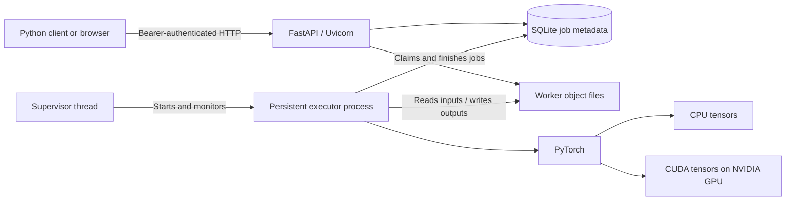

# How Sidecar works

A guide in plain English, followed by the implementation details.

This describes the code in this repository and the verification recorded on **25 October 2026**. It separates implemented CUDA support from the CPU execution and network tests performed on this PC.

## 1. The short answer

Sidecar lets a small client ask a worker to perform a supported computation, then retrieve the answer over HTTP.

The worker uses **PyTorch** to execute that computation on its configured **CPU** or **NVIDIA CUDA GPU**.

**Your current setup:** client, API, and executor run on the same physical PC. The executor uses the CPU. The integrated graphics are unused by this implementation. The network lab introduces realistic application-visible connection failures, but does not create or emulate an RTX 5060.

**The intended two-PC setup:** your i3 PC prepares requests, and the 5060 PC runs a CUDA worker. That physical CUDA setup has not yet been verified.

```text
Current:   client on this PC → HTTP → worker on this PC → this PC's CPU
Intended:  client on i3 PC   → LAN  → worker on 5060 PC → its NVIDIA GPU
```

Having two processes, a pairing token, or a dashboard animation does not establish that two physical computers are involved.

## 2. A simple analogy

Think of the client as someone placing an order and the worker as the workshop that does the work.

| Part | Simple meaning | Actual implementation |
| --- | --- | --- |
| Client | Places an order and supplies the materials | Python SDK, CLI, or browser |
| HTTP connection | Carries materials and messages | Actual HTTP over TCP |
| API | Checks and accepts an order | FastAPI served by Uvicorn |
| Job ID | The order number | A durable identity in SQLite |
| Object storage | Shelves holding materials and finished work | Immutable files on the worker's disk |
| Executor | The person operating the machinery | A separate, persistent Python process |
| PyTorch | Controls the numerical machinery | Tensor operations and fixed model execution |
| CPU or GPU | The machinery doing the calculation | Selected by the worker configuration |
| Pairing token | Authorizes access to the workshop | A bearer token checked by the API |

The client can leave after the order is accepted. The workshop still has the job and its inputs, so another client connection can retrieve it later.

## 3. What the system currently supports

Two registered workloads are implemented:

1. **`matrix.multiply`:** multiply two two-dimensional float32 matrices.
2. **`image.embed`:** extract 576 numerical features from each supported image, using the fixed MobileNet V3 Small encoder.

The image workload is optional and must be enabled and prepared on the worker.

Sidecar does not automatically redirect arbitrary applications to another GPU. An application must use the SDK or API, and its computation must correspond to an implemented workload. PyTorch distributed training, arbitrary uploaded Python programs, model training, game rendering, image generation, and a general inference server are not implemented here.

## 4. The actual architecture



### In plain English

The API receives requests. SQLite records what must be done. The executor performs the calculation. The answer becomes another stored object that the client can download.

### Under the hood

The worker uses one API process and one execution process. A supervisor thread starts and monitors the executor using Python's `spawn` multiprocessing context.

The executor imports PyTorch and initializes its own execution device. The API does not receive a GPU context from the client. No CUDA context or SQLite connection is shared across the process boundary.

SQLite, in WAL mode, coordinates the API threads and executor. `BEGIN IMMEDIATE` transactions serialize important decisions such as job admission, claiming work, cancellation, and committing results. The authoritative queue is in SQLite, so it does not depend on an in-memory list in the submitting client.

A file lock prevents two worker instances from owning the same data directory. The database must be on the worker's local filesystem; sharing its SQLite file across machines is unsupported.

## 5. Follow one matrix job from start to finish

Suppose the client submits:

```text
A = [[1, 2],       B = [[5, 6],
     [3, 4]]            [7, 8]]

C = A × B = [[19, 22],
             [43, 50]]
```

### Step 1: Prepare and identify the inputs

The Python client saves arrays as safe NPY files. Matrix inputs must be two-dimensional, C-contiguous, little-endian float32 arrays. Object/pickle data and malformed payloads are rejected.

The client computes each file's SHA-256 and asks whether the worker already has those exact bytes.

```text
GET /api/v1/objects/lookup/{sha256}
```

A cache hit returns an existing object handle. A miss requires an upload:

```text
POST /api/v1/objects
Authorization: Bearer <private token>
X-Content-SHA256: <file hash>
Body: actual NPY file bytes
```

The API streams the upload to temporary disk, checks its length, recomputes the hash, validates the file, and commits it as an immutable object. The hash detects mismatched or corrupted bytes; it is not encryption.

### Step 2: Submit a small job description

The request refers to remote objects instead of sending the arrays again:

```json
{
  "operation": "matrix.multiply",
  "a": "<remote object handle for A>",
  "b": "<remote object handle for B>",
  "a_shape": [2, 2],
  "b_shape": [2, 2],
  "dtype": "float32"
}
```

`POST /api/v1/jobs` also carries an `Idempotency-Key`. The server validates the description, admits the job within its queue/storage limits, and commits its identity and input references before returning HTTP 202.

**202 means durably accepted. It does not mean the calculation has finished.**

### Step 3: The executor claims the job

The persistent process claims queued work from SQLite. It estimates host-memory requirements and, for CUDA, available GPU-memory requirements. An estimate exceeding the configured admission budget produces a visible failed job rather than an invented success.

These estimates are conservative checks, not guarantees that an allocation cannot fail.

### Step 4: PyTorch performs the calculation

The executor reads the input files, creates tensors, places them on the configured device, and calls `torch.matmul`.

### Step 5: Save and retrieve the result

The worker converts the output to a CPU NumPy array, saves an NPY file, verifies its object metadata/hash, and commits the successful result in SQLite.

The client polls the job, downloads its result, and verifies the received bytes against the stored SHA-256. A numerical reference check can then confirm that those bytes contain the expected answer.

**Hash correctness and numerical correctness are different checks:** a perfectly transferred file could still contain an incorrect calculation.

## 6. What PyTorch actually does

### In plain English

PyTorch is the computation engine inside the worker. It handles arrays of numbers called tensors and dispatches supported operations to the CPU or GPU holding those tensors.

PyTorch does not provide Sidecar's HTTP connection, pairing, durable queue, or object storage. Those are implemented around it.

### The central code

This is a reduced version of [the executor](../sidecar_gpu/executor.py); the actual code also handles admission, cancellation, timing, errors, and durable commits:

```python
import numpy as np
import torch

# These files are already on the worker, having arrived through HTTP.
a = np.load(input_a_path, allow_pickle=False)
b = np.load(input_b_path, allow_pickle=False)

# device is explicitly selected as "cpu" or "cuda" on the worker.
ta = torch.from_numpy(a).to(device)
tb = torch.from_numpy(b).to(device)

with torch.inference_mode():
    result = torch.matmul(ta, tb)

output = result.cpu().numpy()
np.save(output_path, output, allow_pickle=False)
```

### `torch.from_numpy(a)`

This creates a CPU tensor that shares the NumPy array's underlying host memory. Creating that tensor alone does not transfer anything to a GPU. [PyTorch: `from_numpy`](https://docs.pytorch.org/docs/2.7/generated/torch.from_numpy.html)

### `.to(device)`

With `device="cpu"`, the tensor stays on the CPU. When the requested dtype/device already match, PyTorch can return the existing tensor.

With `device="cuda"`, these CPU input tensors are copied into the worker GPU's memory. Both operands must be on the appropriate device for the operation. [PyTorch: `Tensor.to`](https://docs.pytorch.org/docs/2.7/generated/torch.Tensor.to.html)

That RAM-to-VRAM transfer happens **inside the worker PC**. It is a separate step from moving NPY files from the client to the worker over the network.

### `torch.matmul(ta, tb)`

This executes matrix multiplication using PyTorch's implementation for the tensors' device. Python coordinates the call; the numerical work is dispatched to native computation libraries/kernels rather than a Python loop multiplying every element.

A CUDA-capable build plus compatible NVIDIA hardware/driver enables CUDA execution. Installing PyTorch by itself does not create a GPU.

### `torch.inference_mode()`

Sidecar's workloads produce answers without training a model. Inference mode disables autograd-related tracking that these calculations do not need. It does not change CPU tensors into GPU tensors. [PyTorch: inference mode](https://docs.pytorch.org/docs/2.7/generated/torch.autograd.grad_mode.inference_mode.html)

### `result.cpu().numpy()`

For a CUDA result, this brings the numerical output back into the worker's host memory. The output can then be serialized into an ordinary NPY file for HTTP retrieval.

For a CPU result, it is already in host memory.

### Why the executor stays alive

The worker starts its execution process once and reuses it across jobs. PyTorch initialization, the CUDA context, and loaded encoder models can survive between requests. Individual matrix tensors are released after the job; keeping the process alive does not make every uploaded matrix permanently GPU-resident.

## 7. CPU mode versus CUDA mode

| Question | CPU worker | CUDA worker |
| --- | --- | --- |
| Startup option | `--device cpu` | `--device cuda` |
| Main arithmetic | Worker's CPU | Worker's NVIDIA GPU |
| Tensor placement | Host RAM | GPU VRAM for execution |
| CUDA PyTorch build required | No | Yes |
| Client needs an NVIDIA GPU | No | No |
| Proven on this PC | Yes | No |

When CUDA is selected, startup checks `torch.cuda.is_available()` and initializes CUDA. Failure causes startup to fail. The worker does **not** silently substitute CPU execution for a requested CUDA device.

The project's current 5060 setup uses the PyTorch 2.7.1 CUDA 12.8 wheel; see the [installation instructions](../README.md#two-physical-computers-windows-cuda-worker). A compatible NVIDIA driver remains necessary.

Your i3 client needs the SDK and its client dependencies, not PyTorch or a CUDA installation. PyTorch on your i3 would only enable local supported computation; it would not connect it to another PC's GPU.

This is application-level RPC: the client requests an operation from another process/service. It is not PyTorch DDP or transparent sharing of CUDA devices between PCs.

## 8. Three different kinds of reuse

| Kind | What remains available | What that actually saves |
| --- | --- | --- |
| Input object cache | Verified files on the worker's disk | Sending identical input bytes over HTTP again |
| Encoder model cache | An instantiated model in the live executor's memory | Loading and moving model weights again |
| Idempotency | A submission key bound to one job description/identity | Creating a duplicate identity when retrying a submission |

A matrix input cache hit does **not** mean its tensor is already in VRAM. The current matrix executor still reads the file and prepares tensors for each job.

Likewise, retrieving a remote result object handle means the result remains in the worker's object store. It is not a promise that the output is still a live GPU tensor.

Default output protection is 24 hours for retained results, or 10 minutes when retention is disabled. Expired protection makes an object eligible for eviction under storage pressure; expiry is not immediate deletion. Active inputs are protected while their jobs need them.

## 9. The image embedding workload

### In plain English

An image encoder turns a picture into a list of 576 numbers representing features learned by a fixed pretrained model. Sidecar returns those numbers; it does not generate an image or describe it in words.

### Implementation

[The model code](../sidecar_gpu/models.py) uses torchvision's MobileNet V3 Small with ImageNet1K V1 weights and replaces its classifier with `torch.nn.Identity()`.

Images undergo EXIF orientation correction, RGB conversion, and the weight preset's resize/crop/normalization. The resulting tensors are stacked into a batch. The model uses evaluation mode, is moved to the worker's configured device, and runs inside inference mode.

The result shape is `[number_of_images, 576]`. Features are float32 and are not L2-normalized.

Weights are prepared before execution. The fixed checkpoint is checked against the published `047dcff4` SHA-256 prefix and loaded with `weights_only=True`; this is a prefix check, not a separately pinned full-digest check. Jobs neither download models nor accept arbitrary uploaded weight files.

The first embedding job loads the model lazily. Later jobs in the same executor reuse it. Restarting the executor loses the in-memory model cache, while its prepared weight file can remain on disk.

## 10. What happens when a connection or process fails?

### A client disconnects

The accepted job remains in the worker's queue/history. A new client can attach using its job ID.

### The acceptance response gets lost

The server may have accepted the job even though the client never received its ID. The Python SDK saves and fsyncs a local submission receipt before its POST, then attempts a lookup using the same idempotency key after a transport failure.

If that lookup also fails, the SDK raises `SubmissionUncertain`. Recovery uses the original key and parameters. Retrying changed parameters under the same key conflicts.

An idempotency key establishes one identity for an identical submission. It does not guarantee that interrupted numerical execution can resume, or provide exactly-once physical computation across every crash scenario.

### A wait deadline expires

The SDK stops waiting. It does not cancel the accepted job. HTTP request timeouts and the SDK's overall wait deadline are separate controls.

### The executor crashes

The supervisor detects its death, reconciles affected jobs, and attempts replacement. Previously running work becomes `interrupted`; it is not claimed to have resumed. Queued jobs can recover after their input format/hash checks pass.

### A job is cancelled

Queued cancellation is immediate. Running cancellation is cooperative at safe boundaries. A launched CUDA kernel must finish before the executor acknowledges terminal cancellation; this is not a preemptive GPU kill mechanism.

| State | Meaning |
| --- | --- |
| `queued` | Accepted, waiting to execute |
| `running` | Claimed for execution |
| `succeeded` | A successful result was committed |
| `failed` | A visible validation/admission/execution error ended the attempt |
| `cancel_requested` | Cancellation requested; execution has not yet reached its terminal safe boundary |
| `cancelled` | Cancellation acknowledged |
| `interrupted` | The executor was lost; this attempt did not resume |

## 11. What the frontend shows—and what its animations mean

The dashboard reads real endpoints:

| Source | Used for |
| --- | --- |
| `/api/v1/capabilities` | CPU/CUDA device, executor readiness, runtime and limits |
| `/api/v1/metrics` | Job totals, queue depth, object bytes, reservations, cache lookup counters |
| `/api/v1/jobs` | Recent real jobs, results, states and timings |
| Browser performance clock | API response samples observed by this tab |

In **Live** mode, links react to requests and the worker's observed job states. The API-response trace uses measurements from this browser session; it is not a pure network-latency measurement because it includes server response work.

**Walkthrough** is explicitly illustrative. It steps through the protocol without submitting a job or changing job counts. Neither mode proves that the client and worker are physically separate. Animated lines do not measure packets, GPU occupancy, or kernel completion percentages.

**Run a workload** does submit a real job. The browser constructs two dense matrices. Matrix B contains `1/n` everywhere, so the expected answer in each output row is the mean of that row of A:

```text
C[i, j] = sum(A[i, k] × 1/n) = row_mean(A[i, :])
```

The worker performs the actual matrix multiplication. The browser can independently validate all output values with O(n²) work instead of repeating a general O(n³) multiplication. It also checks the downloaded SHA-256. Repeating the same size produces identical input files, demonstrating real cache hits.

Do not use that special O(n²) reference as a performance baseline for general dense multiplication.

The Python CLI benchmark instead calculates a full local NumPy reference after download. Seeing your i3 CPU work during that validation does not establish that the requested worker calculation ran locally.

The pairing token stays in the browser tab's memory. Submission metadata may be retained in session storage for recovery; the token is not stored there.

## 12. What the network simulation establishes

The lab creates separate client, API/executor, and Toxiproxy processes. Actual HTTP traffic passes through real TCP sockets. It adds data-stream latency/jitter, bandwidth caps, outages, interrupted transfers, and lost responses.

It verifies numerical output, cached uploads, independent client reconnection, receipt recovery, concurrent idempotency, temporary-file cleanup, queued-job recovery, and the browser interface.

The recorded regression suite passed **50 tests**, including 14 network scenarios. See [acceptance evidence](acceptance.md) and [the network lab guide](network-lab.md).

Those are meaningful application-level tests. They do not recreate a second OS/kernel, physical Wi-Fi interference, IP packet retransmission, real routing/firewall deployment, a CUDA driver, or a GPU. Toxiproxy's data shaping does not add latency to the TCP handshake and applies bandwidth limits per connection.

The lab briefly suspends its own idle executor to arrange a genuinely queued accepted job for deterministic outage/restart checks. It does not present that as an interrupted GPU kernel.

## 13. Why a remote GPU might still be slower

The complete path has multiple costs:

```text
input preparation + hashing + network upload + queue wait
+ disk loading + RAM-to-VRAM copy + computation
+ VRAM-to-RAM copy + serialization + result commit
+ network download + integrity verification
```

For square float32 matrices, the two inputs need approximately `8 × n²` bytes and the result needs `4 × n²` bytes, excluding file headers and HTTP overhead.

| Matrix size | Two input payloads | Result payload |
| --- | --- | --- |
| 1,024 × 1,024 | 8 MiB | 4 MiB |
| 4,096 × 4,096 | 128 MiB | 64 MiB |

Tiny jobs can spend more time transferring and coordinating than computing. Cache hits remove repeated input network payload, but not necessarily local disk reads, device copies, or result downloads.

Compare the benchmark's transfer-inclusive `client_end_to_end_s` with an appropriate local computation baseline. `gpu_compute_s` alone does not measure the time the user waits.

The CUDA executor uses synchronization and CUDA events to measure completed GPU work rather than just Python launch time. TF32 is disabled for matrix multiplication and cuDNN in this implementation for predictable float32 validation. These paths are implemented but remain unverified on the 5060. [PyTorch CUDA semantics and timing guidance](https://docs.pytorch.org/docs/2.7/notes/cuda.html)

## 14. Defaults and security boundaries

| Setting | Current default |
| --- | --- |
| Executing jobs | One |
| Waiting jobs | Eight |
| Maximum individual upload | 128 MiB |
| Maximum output payload | 128 MiB |
| Managed object/reservation budget | 4 GiB |
| Maximum matrix dimension | 8,192, also subject to file/output limits |
| Host-memory admission fraction | 0.5 of currently available memory |
| GPU-memory admission fraction | 0.75 of currently free GPU memory |
| Images per embedding job | Up to 16 |

Matrix dimension alone is not permission to exceed the byte limits. Weights, database history, logs, and client receipts are outside the managed object budget.

The token authorizes access even if client and worker share a PC. It does not encrypt HTTP traffic or prove a remote GPU exists. The worker is intended for a trusted LAN, with a shared bearer credential; it does not implement individual accounts, tenant isolation, or built-in TLS termination.

Uploads are restricted to supported data formats. The worker does not execute uploaded Python scripts or arbitrary shell commands.

## 15. A small SDK example

This requests multiplication from the worker. The client does not perform `a @ b` to supply the result:

```python
from pathlib import Path
import numpy as np
from sidecar_gpu.client import Client

address = "http://GPU_PC_IP:8377"  # Replace with the actual reachable worker address.
token = (Path.home() / "sidecar-worker.token").read_text().strip()

with Client(address, token) as worker:
    a = worker.upload_array(np.ones((128, 64), dtype=np.float32))
    b = worker.upload_array(np.ones((64, 32), dtype=np.float32))
    job = worker.multiply(a, b)
    job_id = job.id

# A separate connection can retrieve the same accepted job.
with Client(address, token) as worker:
    job = worker.attach(job_id).wait(timeout=120)
    job.download("result.npy")
    print(job.data["result"]["metadata"]["execution_device"])
    print(job.timings)
```

The actual execution device depends on the worker. For a CUDA-only acceptance test, use `scripts/two_machine_demo.py`, which requires CUDA in both capabilities and result metadata. Physical separation still requires checking the actual machines.

## 16. Where to read the implementation

| File | Responsibility |
| --- | --- |
| [`client.py`](../sidecar_gpu/client.py) | SDK uploads, receipts, idempotent submission, polling, verified downloads |
| [`api.py`](../sidecar_gpu/api.py) | HTTP routes, startup lifecycle, streaming object storage interface |
| [`guard.py`](../sidecar_gpu/guard.py) | Early bearer authentication and bounded non-upload request bodies |
| [`store.py`](../sidecar_gpu/store.py) | SQLite state, queue claims, objects, reservations, leases, retention and reconciliation |
| [`supervisor.py`](../sidecar_gpu/supervisor.py) | Spawn, monitor, reconcile and replace the executor |
| [`executor.py`](../sidecar_gpu/executor.py) | Actual PyTorch CPU/CUDA execution and measurements |
| [`models.py`](../sidecar_gpu/models.py) | Fixed encoder preparation, image validation, preprocessing and model loading |
| [`config.py`](../sidecar_gpu/config.py) | Worker defaults, configuration and pairing-token loading |
| [`benchmark.py`](../sidecar_gpu/benchmark.py) | Transfer-inclusive reports and independent local numerical validation |
| [`dashboard.ts`](../sidecar_gpu/static/dashboard.ts) | Live interface, browser submission, recovery, diagram and activity |
| [`workload.js`](../sidecar_gpu/static/workload.js) | Browser NPY encoding, SHA-256 and known-reference checks |
| [`network_lab.py`](../scripts/network_lab.py) | Repeatable network fault lab and process control |
| [`test_network_lab.py`](../tests/test_network_lab.py) | Real TCP fault scenarios and recovery assertions |

## 17. Terms worth remembering

| Term | Meaning |
| --- | --- |
| Tensor | A typed numerical array used by PyTorch |
| CPU | The processor performing general-purpose computation |
| CUDA | NVIDIA's GPU compute platform used by this worker |
| VRAM | Memory on the GPU, distinct from the computer's ordinary RAM |
| Kernel | A computation launched on the GPU |
| Serialization | Encoding an array into bytes that can be stored or transferred |
| SHA-256 | A fingerprint used to identify and verify exact bytes |
| Object handle | The API identifier for a stored input or result |
| Job ID | The durable identity of one accepted execution attempt |
| Idempotency | Retrying an identical submission under the same key preserves its identity |
| Persistence | State survives the original client connection or a supported process restart |
| Inference | Running a prepared model to produce outputs, without training it |
| Latency | Delay before or during communication |
| Bandwidth | The rate at which data can move |
| End-to-end time | Time through the complete measured client/worker path |

**The central distinction:** Sidecar moves requests and data between clients and workers. PyTorch performs the worker's numerical computation. The worker's selected hardware determines whether that computation is CPU execution or actual GPU offloading.
