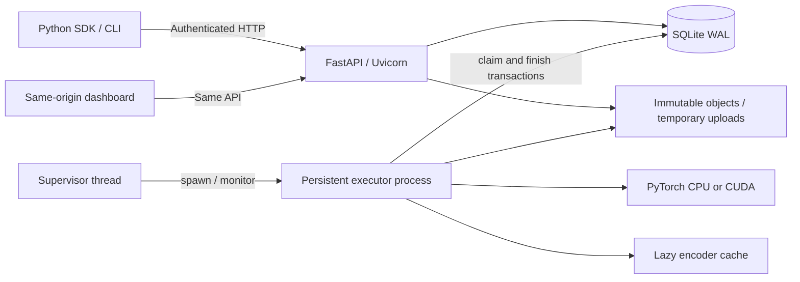
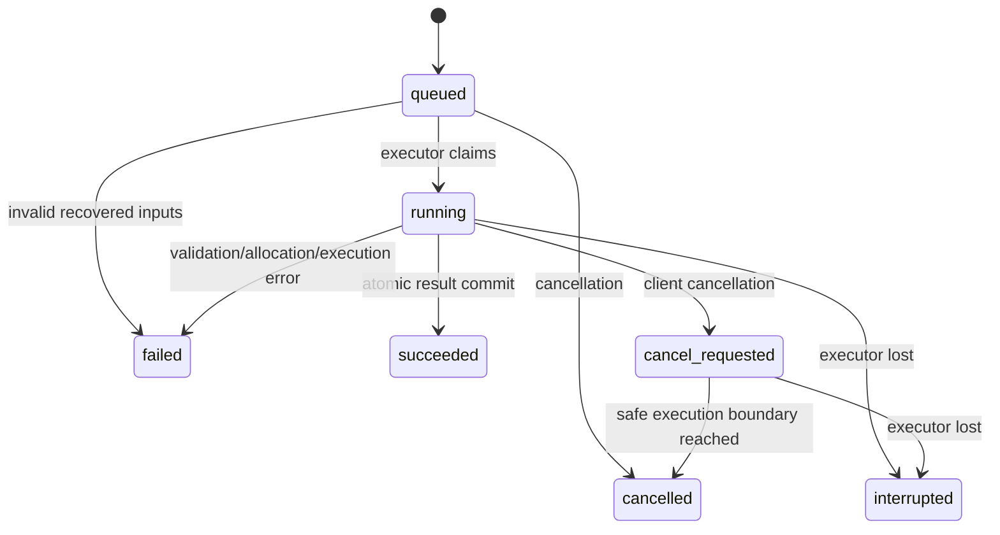

# Architecture and protocol v1



One worker host coordinates and executes. Uvicorn has one process; its lifespan holds an OS-backed file lock on the storage directory. SQLite `BEGIN IMMEDIATE` serializes queue admission, claims, cancellations, leases, reservations and result commits across API threads and the executor. Connections are short-lived; no SQLite connection or CUDA context crosses a spawn boundary. CPU computation/model loading/file hashing happens in the executor or API thread pool, not the HTTP event loop. Upload network iteration is asynchronous and file chunks are written through the thread pool.

The spawned executor imports PyTorch and initializes the explicitly selected device. It owns model tensors until it exits. It claims jobs FIFO from SQLite, so a client disconnect has no execution-lifecycle effect. There is no authoritative in-memory job queue or callback dependency on an original client connection. Actual device identity originates in the executor and accompanies results.

## API

Prefix: `/api/v1`. All endpoints except health require `Authorization: Bearer TOKEN`. Dashboard static assets are unauthenticated and contain no worker data. API errors use:

```json
{"error":{"code":"queue_full","message":"waiting queue is full; retry with the same key later","details":{}}}
```

| Method | Endpoint | Contract |
| --- | --- | --- |
| GET | `/health` | Minimal readiness/version; no resource details |
| GET | `/capabilities` | Enabled operations, executor/device, limits, weight availability |
| GET | `/metrics` | Real job counts, storage/reservations, hash lookup counters, device samples |
| GET | `/objects/lookup/{sha256}` | `{exists, object}`; hit refreshes access/grace without payload upload |
| POST | `/objects` | Raw bytes; `X-Content-SHA256`; safe NPY or enabled JPEG/PNG; 201 object metadata |
| GET | `/objects/{handle}` | Verified object metadata or 404/410 |
| GET | `/objects/{handle}/download` | Authenticated streaming file response, temporary download lease |
| POST | `/jobs` | Typed registered workload + `Idempotency-Key`; 202 durable job snapshot |
| GET | `/jobs?limit=50` | `{jobs: [...]}`, most recent first, maximum 200 |
| GET | `/jobs/by-key/{key}` | Recover accepted identity after response loss |
| GET | `/jobs/{id}` | Durable status, parameters, errors, result handles and timings |
| POST | `/jobs/{id}/cancel` | Idempotent cancellation request; returns truthful current state |
| GET | `/jobs/{id}/result` | Result object metadata; 409 until success, 410 after eviction |
| GET | `/jobs/{id}/result/download` | Convenience authenticated result download |

Objects use `o_` plus random UUID hex; jobs use `j_` plus UUID hex. Handles never form filesystem paths. Blob paths derive only from validated SHA-256. One token represents one trusted-team namespace. HTTP status codes: 401 authentication, 404 unknown identity, 409 conflict/not ready, 410 unavailable object, 413 byte/output/batch limits, 422 typed/format validation, 429 queue full, 503 executor unavailable, 507 storage reservation failure. Admission failure after acceptance becomes a failed job with a useful error code.

Matrix submission:

```json
{
  "operation":"matrix.multiply",
  "a":"o_00000000000000000000000000000001",
  "b":"o_00000000000000000000000000000002",
  "a_shape":[512,256],
  "b_shape":[256,128],
  "dtype":"float32",
  "retain_output":true,
  "retry_of":null
}
```

Optional image submission:

```json
{
  "operation":"image.embed",
  "images":["o_00000000000000000000000000000001"],
  "model":"mobilenet_v3_small.imagenet1k_v1.features576",
  "retain_output":true,
  "retry_of":null
}
```

Unknown fields/operations/dtypes are rejected. Shapes must match immutable object metadata. Only one fixed encoder identity is accepted. Image batch order and duplicates are preserved in output rows. Inputs are always file-backed remote objects; a cache hit never implies GPU residency. Uploaded tensors/model executables and arbitrary Python are not supported. JSON bodies are limited to 64 KiB before parsing; authentication happens before body buffering.

## Atomicity, retention and failure

Uploads reserve a bounded amount of disk budget, stream to a unique temporary file, verify SHA-256 and format/length, fsync and atomically rename within the data directory. Only afterward does SQLite make the object visible. Concurrent duplicate uploads converge on the same object handle. Failed/disconnected uploads remove temporary files and reservations. Startup removes leftover temporary/orphan blobs. The SDK atomically replaces downloaded files only after verifying size and SHA-256.

Acceptance transaction checks idempotency first, validates remote handles/parameters, enforces queue/output limits, reserves space, records input references, and writes `queued`. Responses happen after commit. Canonical parameter JSON binds an idempotency key forever; changing parameters returns conflict even after completion. Output reservation is conservative, including NPY header allowance. Queued/running inputs are never eviction candidates, including the inputs of a submission currently reserving its output.

Least-recently-accessed eviction happens under the same transaction used for reservation. Grace, output retention, active-job references and download leases prevent removal. Blob bytes, object metadata and job provenance are distinct: equal output bytes can deduplicate against an input while the job still records its own device/model provenance. Historic object metadata is retained after eviction, so unknown and expired handles are distinguishable.

State transitions:



Terminal cancellation wins if it races with result commit before the final transaction checks state. Already completed jobs remain completed. An in-flight GPU kernel is synchronized before cancellation acknowledgement. The supervisor marks abandoned work interrupted only after verifying the executor exited, validates queued inputs by hash, and spawns a replacement. It preserves concurrent API-upload reservations. Three consecutive failed replacement startups leave the executor unavailable and reject new submissions. Process death after computation but before result commit is still interrupted, never implicitly resumed. Pure operations can be explicitly retried with a new key and `retry_of` link.

SQLite job metadata survives worker/client disconnects and is not automatically deleted. Retention is protection against pressure eviction, not scheduled deletion. Filesystem and SQLite are not one power-loss transaction; startup removes unreferenced files, and missing blobs report unavailable rather than claiming a retrievable result. This prototype assumes local storage with adequate free space and does not claim protection from disk corruption or a malicious administrator.

## Timing semantics

Durations use `perf_counter`/`monotonic` within each machine. Unix timestamps are labels only. Queue wait is persisted from the worker's monotonic clock; restarted queued jobs reset its origin and set `queue_recovered=true`, excluding offline downtime. Worker total covers admission, model work, input loading, synchronized compute, serialization, hashing and result commit preparation; the last SQLite commit/fsync return and polling overhead appear in client end-to-end latency.

`compute_s` measures wall duration with CUDA synchronization; `gpu_compute_s` uses CUDA start/end events. Host/device transfers are separately synchronized and measured. CPU mode marks CUDA-only metrics null. Image preprocessing is included in input loading. Model loading reports actual first-load time, then zero with `model_cache_hit=true`; these are independent of disk input/output cache hits. The result hash timing is a component of result commit, not an additional interval to sum twice.

Client reports record successful payload bytes (excluding HTTP/TCP headers), upload network duration, lookup, hashing, download/hash verification, and total observed latency. Zero-byte hits still incur lookup/hash time. A failed upload can have transmitted partial bytes and is not represented by a successful transfer receipt. Polling delay and protocol overhead can dominate small workloads; benchmark reports make no placement recommendation. Device telemetry is sampled between jobs; `sampled_at` exposes freshness and GPU utilization stays unavailable.
