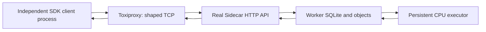

# Network fault lab on one Windows PC

This runs the actual Sidecar SDK, HTTP API, durable storage, and persistent CPU executor through a separate [Toxiproxy](https://github.com/Shopify/toxiproxy/tree/v2.13.0) process. It needs no VM, Docker, NVIDIA GPU, firewall changes, or additional Python dependencies beyond the worker/test environment.

It is a single-host network fault test. It cannot establish two-machine deployment compatibility, CUDA correctness, or GPU speedup. Both sides share the host kernel, CPU, RAM, disk, and user permissions. Separate folders are not an OS security boundary.

## Run

From the repository root, with the existing worker/test environment:

```powershell
# First use: download the pinned 12 MB Windows x64 proxy and check its SHA-256.
.\.venv\Scripts\python.exe scripts/network_lab.py --download --browser

# Later runs work offline.
.\.venv\Scripts\python.exe scripts/network_lab.py --browser
```

`--browser` additionally requires the already installed Playwright Python package and Microsoft Edge. Omit it to skip that one test. No browser download is performed. The normal matrix suite requires CPU PyTorch on the worker side; the independent client processes never import it.

The downloaded executable is Toxiproxy **2.13.0**, fetched only from the official GitHub release and verified against its pinned release asset digest. It lives under `.sidecar/tools`, outside the source archive. Other platforms can supply their own matching binary with `--toxiproxy PATH`; automatic download is Windows x64 only.

Each invocation creates a new directory under `.sidecar/network-lab`; `--output PATH` changes its parent. Existing runs are preserved. The script binds dynamically selected loopback ports and stops its own worker, executor, client and proxy processes afterward. It does not change an existing Sidecar worker or the machine's network configuration.

## Actual data path



Clients work in `client/`, store their own receipts, and upload actual NPY files through HTTP. The worker owns a different `worker/` directory. A submitting client exits completely; a new client process reconnects and downloads the result. SHA-256 verification and a local NumPy reference validate the returned bytes and numbers.

The test controller has a separate direct HTTP observer connection to establish what the worker did while the client link was unavailable. Client task traffic always uses the proxy. Controller observations are labeled in the evidence; they are not used as a client result shortcut.

## Synthetic link profiles

These settings are illustrative test inputs, not measurements of your Wi-Fi or another computer. Latency is configured independently in both directions; bandwidth caps apply per connection, not to a shared physical link. Rates use decimal KB/s (1 KB = 1,000 bytes), matching [Toxiproxy's bandwidth implementation](https://github.com/Shopify/toxiproxy/blob/v2.13.0/toxics/bandwidth.go).

| Profile | Added delay per direction | Jitter per direction | Upload cap | Download cap |
| --- | --- | --- | --- | --- |
| Clean | 0 ms | 0 ms | None | None |
| Wi-Fi-like | 15 ms | 5 ms | 2,048 KB/s | 6,144 KB/s |
| Slow link | 60 ms | 15 ms | 256 KB/s | 512 KB/s |
| Fragmented stream | 5 ms | 0 ms | None | None |

The fragmented profile splits data into roughly 1 KiB stream writes with varying sizes, checking HTTP streaming and parsing. These are not IP packets. A separate calibration measures five baseline health requests and five requests with a fixed 50 ms delay in each direction. Upload durations are checked against the configured bandwidth limits with allowance for buffering and scheduling.

The four workload profiles each upload two 512-by-512 float32 matrices, submit and reconnect using separate processes, verify the result, then repeat with cached inputs. These sizes keep the lab usable on an i3 with limited free RAM. This lab evaluates communication and failure behavior, not sustained GPU load or comparative compute performance.

## Failure checks

- Missing and wrong bearer credentials are rejected across the proxy.
- Accepted work completes while the client link is disabled; a later process retrieves the same result. The test briefly suspends its own idle executor to arrange a genuinely queued job before disconnecting, then resumes it while the link remains down.
- An SDK wait deadline does not cancel the queued job.
- A downstream blackhole hides the acceptance response and the SDK's lookup response. The client produces `SubmissionUncertain` and a durable receipt. Reconnection and an identical retry recover exactly one accepted identity.
- An upload connection closes after 8 KiB. The worker clears temporary files and reservations and accepts a later full retry.
- A download connection closes after 8 KiB. The SDK preserves an existing destination, removes its partial download, and later downloads and verifies the complete result.
- A blackholed response triggers a bounded client read timeout.
- Two concurrent client processes submitting the same idempotency key receive one job identity.
- The entire lab worker process tree is killed with a real accepted job queued. Restarting against the same local worker storage recovers that queue and serves a result completed before the crash. Executor suspension makes the queued state deterministic; this does not claim that an in-flight GPU kernel was interrupted.
- With `--browser`, installed Edge pairs with the real API through the Wi-Fi-like profile, checks invalid credentials, inspects a job, downloads and verifies a result, and checks desktop/mobile rendering and disconnect behavior.

Uploads and downloads retry as whole transfers. This does not implement or claim byte-offset resume.

## Evidence and limits

The run prints the artifact directory containing:

- `summary.json` and `tests.xml`: exit status, pass/failure/skip counts and durations.
- `evidence.json`: topology, actual process IDs, profile settings, measured timing samples, independent client reports, correctness, caching, failure and recovery evidence.
- `logs/`: worker, proxy and client subprocess output.
- `client/`: inputs, outputs, receipts and optional browser screenshots/report.
- `worker/`: actual durable worker database and immutable objects.

Pairing token files stay in the ignored run directory. Reports and logs do not intentionally contain token values. Do not share the entire run directory without first removing its token files.

Toxiproxy terminates two real TCP connections and affects their data streams. It does not model TCP handshake latency, real packet loss/retransmission, congestion control across a shared network, MTU, ARP, DNS, routing, radio interference, NAT, Windows firewall rules, separate machine failures, or CUDA/VRAM behavior. Its chunk-dropping `packet_loss` toxic is deliberately not used as a substitute for IP packet loss: silently deleting bytes from an established TCP stream would test a different failure.

For packet-level fidelity, a later lab can use isolated Linux machines/network namespaces and [`tc netem`](https://man7.org/linux/man-pages/man8/tc-netem.8.html). Final hardware acceptance still requires the actual client and GPU worker.
